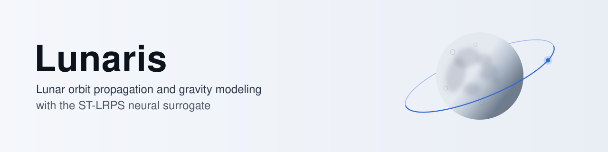

<p align="center">
  <picture>
    <source media="(prefers-color-scheme: dark)" srcset="docs/assets/lunaris-banner-dark.svg">
    
  </picture>
</p>

# Lunaris

**Lunar orbit propagation and gravity-modeling framework.**

[](https://www.python.org/downloads/)
[](LICENSE)

**[Quickstart](#install-and-quickstart)** · [Results](#results-so-far) ·
[Documentation](docs/README.md) · [HPC guide](docs/HPC.md) ·
[Architecture](docs/ARCHITECTURE.md) · [Changelog](CHANGELOG.md)

## What Lunaris does

Lunaris is a Python framework for lunar orbits. It has these parts:

- Spherical-harmonic lunar gravity.
- Configurable physical force models.
- Orbit propagation with adaptive and fixed-step integrators.
- Batch/ensemble propagation and injection dispersion analysis.
- Validation harnesses and visualization tools.
- A PySide6 desktop UI (Lunaris Mission Studio).

Lunaris also contains **ST-LRPS** (Sobolev-Trained Lunar Residual Potential
Surrogate), a neural surrogate-gravity model in `lunaris.surrogate.st_lrps`.
A propagator keeps a low-degree spherical-harmonic baseline and adds the
gradient of a learned residual potential. The network learns only what the
baseline misses, and the force is conservative by construction. ST-LRPS has its
own training, evaluation and Studio UI.

## Results so far

These are measured results for **one trained model**: a 512×5 residual SIREN
(1,848,321 parameters) that corrects an SH25 baseline toward the SH200 field of
the GRAIL GL1800F model, trained on 100–1000 km altitude. Every number below
comes from a run artifact listed in
[docs/BENCHMARK_RESULTS.md](docs/BENCHMARK_RESULTS.md#research-preview-results).
They are research-preview results, not paper-safe evidence (see
[Status and limits](#status-and-limits)).

**Inside its training band the surrogate matches the SH200 residual field to
0.067° in direction on average; below 100 km it does not.**

| Held-out set | Altitude [km] | Samples | Acceleration RMS error [m/s²] | Mean direction error [°] | Median magnitude error [%] |
|---|---:|---:|---:|---:|---:|
| Below the band | 60–100 | 0.5 M | 3.8e-5 | 2.7 | 2.8 |
| Test | 100–1000 | 2 M | 1.9e-8 | 0.067 | 0.018 |
| Above the band | 1000–1040 | 0.5 M | 7.3e-12 | 0.72 | 1.3 |

Errors are of the residual acceleration (SH200 minus SH25) in the Moon-fixed
frame. The surrogate is never worse than leaving the correction out on the test
set.

**Over five days the surrogate ends a median 1.1 cm from the SH200 trajectory;
the SH25 baseline alone ends 18 m away.**

| Gravity model | Median final error [m] | P95 [m] | Max [m] | Orbits within 10 m [%] |
|---|---:|---:|---:|---:|
| SH25 baseline alone | 18 | 1200 | 7000 | 40 |
| SH25 + ST-LRPS | 0.011 | 0.69 | 2.5 | 100 |

256 orbits (scrambled Sobol, 100–1000 km), 5 days, fixed-step RK4 with
Δt = 15 s, float64, gravity only. The reference is SH200 under the same
integrator. The correction cuts the median final error by a factor of 1730.

**On eight classical frozen-family candidates over 60 days, the surrogate
reproduces the eccentricity change to within 0.14 %; SH25 alone misses up to
49 %.**

| Gravity model | Max Δe error [% of reference] | Max Δω error [°] | Median day-60 position difference [m] |
|---|---:|---:|---:|
| SH25 baseline alone | 49 | 3.0 | 24 000 |
| SH25 + ST-LRPS | 0.14 | 0.046 | 50 |

Candidates: perilune 100–200 km, e = 0.03–0.06, i = 27–90°, ω₀ = 90°, RK4
Δt = 15 s, reference SH200. The reference changes reach Δe = 7.5e-3 and
Δω = 107°.

**A 4096-orbit, 60-day frozen-orbit screening ran in 51 h on a laptop GPU. The
same campaign with SH200 on the CPU is estimated at about 74 days.**

| Run | Backend | Wall time [h] | Source |
|---|---|---:|---|
| ST-LRPS, gravity only | `gpu_st_lrps_potential` (GPU) | 51 | measured |
| ST-LRPS + Sun/Earth | `gpu_st_lrps_third_body` (GPU) | 46 | measured |
| SH25 control | `torch_cpu_sh` (CPU) | 56 | measured |
| SH200 | CPU | ≈ 1800 (74 days) | extrapolated |

All runs: one laptop with an NVIDIA GTX 1660 Ti, RK4 Δt = 30 s, output every
10 min. Read the cost numbers with these limits:

- The SH200 figure is not a campaign run. It scales the measured SH200 cost
  per five-day orbit (190 s on the CPU) to the campaign and calibrates it against
  the measured SH25 campaign.
- It compares a GPU run with a CPU run. On the same GPU the surrogate costs
  1.27× the SH25 baseline alone. An SH200 timing on the same GPU has not been
  measured.
- In the five-day benchmark the surrogate took 14 s per orbit on the GPU, 13×
  less than CPU SH200. Per-orbit cost depends on batch size, and the CPU SH200
  series covered 256 orbits, not 1024.
- Training took 43.6 h on the same GPU. At 13× per orbit it pays back after
  about 900 five-day orbits.

## Status and limits

Read these notes before you use the results.

> **ST-LRPS is a research preview.** The results above hold for one model, one
> training run and the stated configurations. They are not a general accuracy,
> speed, spatial-generalization or orbit-stability claim. The full paper-safe
> evidence chain is not complete yet: spatial-block split, A0–A6 ablations,
> curl/energy diagnostics and complete benchmark artifacts. Below the training
> band (60–100 km) the median magnitude error rises from 0.018 % to 2.8 % and
> the mean direction error from 0.067° to 2.7°, so do not use the surrogate
> there. Use the classical spherical-harmonic engine for
> production numbers. See
> [docs/ST_LRPS_VALIDATION_HYGIENE.md](docs/ST_LRPS_VALIDATION_HYGIENE.md) and
> [docs/PAPER_SAFE_POLICY.md](docs/PAPER_SAFE_POLICY.md).

> **ST-LRPS is a batch gravity backend.** It is not a low-latency replacement
> for one CPU trajectory. One trajectory through `propagate()` evaluates the
> surrogate as an interpreted PyTorch + autograd closure. This path is *slower*
> than the `@njit` spherical-harmonic kernel. The surrogate is faster only
> across a large GPU batch. Do **not** compare "ST-LRPS vs SH" with one CPU
> trajectory. Compare the two on the GPU batch backend. See
> [docs/profiling.md](docs/profiling.md).
>
> GPU ST-LRPS has two backend variants:
>
> - `gpu_st_lrps_potential`: surrogate lunar gravity only.
> - `gpu_st_lrps_third_body`: surrogate lunar gravity **plus analytic vectorized
>   Sun/Earth third-body** (Battin F(q) formulation).
>
> GPU ST-LRPS does not support SRP, albedo, thermal IR, solid tides, relativity
> or Earth J2. A run that needs them falls back to the CPU and records the
> reason, or stops with an error under the strict backend policy. The run never
> simplifies the force model silently. See
> [docs/backend_matrix.md](docs/backend_matrix.md). A benchmark table never
> mixes gravity-only results with full-dynamics results.

> **CUDA backends are experimental.** There is no recurring GPU CI: the nightly
> CUDA workflow needs a self-hosted GPU runner. We validate the GPU paths
> manually for each release. CPU results are the reference. GPU runs record the
> requested and the actual backend. If a GPU path cannot run, the run falls
> back to the CPU and records the reason.

> **Project status.** Lunaris is research software in active development. It
> is in a **0.1.x pre-release (release-candidate) line**. There is no stable
> 1.0 API yet. [docs/VERSIONING.md](docs/VERSIONING.md) sets what each release
> can claim. The classical spherical-harmonic engine has the validation
> evidence in `docs/`. Datasets, checkpoints, runtime and benchmark artifacts
> have versioned on-disk contracts. Public APIs can change between releases, so
> pin a version for reproducible work. A trained artifact or a benchmark number
> applies only to its run and configuration.

## Install and quickstart

**Supported platforms.** The table shows where we develop and test Lunaris:

| Platform | Status |
|---|---|
| Windows 10/11 (x86-64) | Supported. Primary development platform; Python 3.11 core/wheel smoke CI |
| Ubuntu LTS (x86-64) | Supported. Full CI (tests, lint, type, architecture gates) runs here headless |
| Other Linux distributions | Expected to work (pure Python and wheels); not tested routinely |
| macOS | **Untested.** No CI and no manual validation |

Lunaris supports Python 3.10–3.12 (CI matrix). PyTorch installs as the **CPU
wheel by default**. For CUDA, install the matching GPU build *before* the
extras. Example:

```bash
pip install torch --index-url https://download.pytorch.org/whl/cu121
```

Install Lunaris in editable mode from the repository root. This step installs
the console entry points. Code changes then apply without a new install.

```bash
python -m pip install -e ".[all]"     # core + ML + UI + reports + dev extras
python -m pip install -e .            # core dependencies only
```

`pyproject.toml` has these optional dependency groups: `ml`, `hpc`, `ui`,
`reports`, `dev`, `all`. Each dependency has a lower and an upper version
bound, so a build cannot pull in an incompatible major release. For
reproducible environments, use the exact pins in `locks/*.lock.txt`
(generated with `uv`). For clusters, see
[Train on a Slurm cluster](#train-on-a-slurm-cluster).

These checks need no local datasets:

```bash
python -c "import lunaris; print(lunaris.__version__)"
lunaris-train --help
lunaris-eval --help
lunaris-benchmark --help
lunaris-batch --help
lunaris-perturbation-budget --help
python -m lunaris.surrogate.st_lrps.training.cli --help
python -m lunaris.surrogate.st_lrps.evaluation.cli --help
python -m lunaris.surrogate.st_lrps.evaluation.compare_gravity_models --help
python -m lunaris.visualization.surface_explorer --help
```

### Mission data

Full propagation, ST-LRPS training, gravity validation and topography plots
need local gravity, SPICE or LOLA files. This data is **not bundled**. Use the
headless `lunaris-data` tool to download and verify it into `LUNARIS_DATA_DIR`
(or the repository `data/` folder):

```bash
lunaris-data list
lunaris-data download --preset full-gravity
lunaris-data verify --strict --runtime
```

The `full-gravity` preset contains all ephemeris and gravity assets that strict
runtime verification needs, including `gm_de440.tpc`. A plain
`download --group ephemeris` does not include `gm_de440.tpc`, but `--strict`
needs it. To download by group, include the optional entries:

```bash
lunaris-data download --group ephemeris --include-optional
lunaris-data download --group gravity
lunaris-data verify --strict --runtime
```

The catalogue is `data/data_sources.json`. Official entries download from
NAIF/JPL or NASA PDS. `lunaris-data verify` checks the recorded hashes.
`--strict --runtime` also builds a small ephemeris table from the resolved
SPICE kernels. The usual locations are `data/ephemeris_models/`,
`data/gravity_models/`, `data/topography_models/`, `data/albedo_models/`,
`data/thermal_models/` and `data/assets/`. ST-LRPS cloud suites are generated
artifacts in `data/datasets/`; they are not downloads.

> **Installed / wheel use:** The repository `data/` fallback works only in an
> editable checkout (the project-root marker finds it). If you install Lunaris
> as a wheel, set `LUNARIS_DATA_DIR` to your data root. You can also give an
> explicit `--kernel-dir` / `--gravity-file-path` to the CLI.

## Use Lunaris

### Force models

The propagator (`lunaris.core.dynamics`) applies these force models:

- Spherical-harmonic lunar gravity (and the ST-LRPS surrogate-gravity model)
- Third-body perturbations (Sun, Earth)
- Earth oblateness (differential J2)
- Solar radiation pressure, with eclipses. The adaptive integrator restarts at
  each shadow boundary.
- Lunar albedo (reflected sunlight) surface radiation
- Lunar thermal IR radiation pressure
- Elastic lunar solid-body tides (`k2`, optional explicit `k3`; raised by the
  Earth and/or the Sun)
- First-order post-Newtonian relativity

You can set each model from the `lunaris` CLI. For the full flag reference,
assumptions and limits, see [docs/ARCHITECTURE.md](docs/ARCHITECTURE.md).
Examples:

```bash
lunaris --enable-tides on --tides-kind k2 --tide-bodies earth,sun
lunaris --enable-thermal on --thermal-mode equilibrium_temperature
lunaris --enable-albedo on --albedo-mode scaled_dn_grid --albedo-root data/albedo_models
```

### Batch ensembles and analysis

`lunaris` runs one propagation. The primary `lunaris-batch` command runs
propagated ensembles. Each ensemble run declares its sampling design. `random`
is the classical Monte Carlo design. `lhs`, `sobol` and `sobol_scrambled` are
space-filling designs for validation and benchmark coverage.

The batch backends are explicit: `cpu_sh` (truth reference), `numba_cuda_sh`,
`torch_cuda_sh`, `torch_cpu_sh`, `gpu_st_lrps_potential` and
`gpu_st_lrps_third_body`. `lunaris.batch.backend_policy` selects the backend.
The batch result records the requested and the effective backend, device,
integrator, sampling method and each fallback reason. No fallback occurs
silently. The perturbation budget tool shows acceleration contributions and
force-model uncertainty:

```bash
lunaris-perturbation-budget --altitudes-km 50,100,300,1000 --sh-degrees 20,60,200 \
  --gravity-model path/to/lunar_gravity_model.tab --out-dir outputs/perturbation_budget/default
```

Mission Monitor replay uses the exact output grid that the solver returns. It
does not use adaptive Runge–Kutta stage evaluations. Live RHS observations are
explicit `rhs_probe` samples. `telemetry.ndjson` and the scientific trajectory
widgets do not include them. Old telemetry without sample semantics stays
readable, but it has an "uncertain" label. See
[docs/MISSION_MONITOR.md](docs/MISSION_MONITOR.md).

Post-processing, reports and ensemble statistics/plots are in
`lunaris.analysis.*`. See [docs/ARCHITECTURE.md](docs/ARCHITECTURE.md).

### Frozen-orbit search

`lunaris-frozen-search` runs a frozen-orbit campaign in stages:

1. Element samples.
2. A batched screening pass (ST-LRPS or torch SH, optionally with Sun/Earth
   third-body terms).
3. A scored shortlist.
4. Classical-SH validation of the shortlist.
5. A family report.

Each stage writes its own artifact (`stage0_samples.npz` …
`stage4_families.json`). Screening saves a checkpoint every
`--screening-checkpoint-minutes` (default 20). `--resume` continues an
interrupted run from the last checkpoint with bitwise-identical trajectories.
`FrozenClassificationConfig.for_mission_duration` sets the classification
thresholds. Each rate limit, including the inclination rate, is its envelope
limit divided by the arc length. The labels describe one simulated arc. They
are not a universal definition of a frozen orbit.

### Visualization

The standalone tools are in `src/lunaris/visualization/`. For orbit
animation, use `lunaris.visualization.orbit_animation.render_orbit_animation`.
For topography and albedo, use `lunaris.visualization.surface_explorer`:

```bash
python -m lunaris.visualization.surface_explorer \
    --topo-label data/topography_models/ldem_64_float.lbl \
    --topo-img data/topography_models/ldem_64_float.img \
    --out-dir outputs/surface_explorer --plot-2d --plot-3d
```

Large LOLA grids use much memory. For quick previews, use
`--stride-2d`/`--stride-3d`/`--stride-albedo`.

## ST-LRPS

```bash
# dataset generation, training, evaluation, ablation
python -m lunaris.surrogate.st_lrps.data.spatial_cloud_generator --help
python -m lunaris.surrogate.st_lrps.training.cli --help
python -m lunaris.surrogate.st_lrps.evaluation.cli --help
python -m lunaris.surrogate.st_lrps.evaluation.ablation --help
```

At runtime, ST-LRPS has one artifact contract: `potential_autograd`. The network
learns a scalar residual potential. Autograd gives the acceleration, so the
force is conservative by construction. The earlier experimental `force_direct`
model (3-output direct residual acceleration, not conservative) is archived in
the `experimental/force-direct-archive` branch. On main it stops with an error.
Versioned `artifact_contract` / `dataset_contract` blocks record the target
semantics, baseline degree, altitude envelope, scaler contract, encoding and
runtime kind.

Select the run posture with `--run-preset {development,quick,paper}`. The
`paper` preset enforces a generalization split, deterministic execution and the
preflight gate. Reproducible config-driven benchmarks:

```bash
lunaris-benchmark --config configs/benchmarks/st_lrps_1day_high_degree.json
lunaris-benchmark --config configs/benchmarks/st_lrps_1day_high_degree.json --quick
```

For contracts, validation hygiene and reproducible HPC sweeps, see
[docs/CONFIG_AND_ARTIFACT_CONTRACTS.md](docs/CONFIG_AND_ARTIFACT_CONTRACTS.md),
[docs/ST_LRPS_VALIDATION_HYGIENE.md](docs/ST_LRPS_VALIDATION_HYGIENE.md) and
[docs/HPC.md](docs/HPC.md#1b-st-lrps-scenario-arrays-reproducible-sweeps).

### Exit codes

`lunaris-train` gives these exit codes:

| Exit | Meaning |
|------|---------|
| `0` | The run completed. |
| `75` | A stop signal stopped the run after it saved `ckpt_last.pt`. You can resume the run. |
| `1` | The run failed (NaN/Inf loss, stopped periodic evaluation) or an error occurred. |
| `130` | A second stop signal forced the stop. The current epoch was not saved. |

A second stop signal less than 5 s after the first has no effect. Slurm and the
job script can send the same stop two times.

### Resume training

The trainer saves a checkpoint after each epoch. Resume restores the optimizer,
LR schedule, GradNorm and RNG state, not only the weights.

1. Use the resume command that the trainer prints when it stops. The run
   manifest also records this command (`resume_hint`).
2. Keep all original flags in the command. Add `--resume-from <run-dir>`.
3. Set `--epochs` to the **total** epoch count, not to the additional epochs.

Do not use `--resume-from` alone. Resume locks only the network structure and
the scaler. A bare `--resume-from` sets the batch size, the learning rate and
the loss weights to their default values. The trainer then writes a warning
that lists each setting that changed. A bare resume restores the data files of
the run, including separate `--train-data` / `--val-data` files.

For the full semantics, see [docs/ARCHITECTURE.md](docs/ARCHITECTURE.md).

### Train on a Slurm cluster

The `hpc/` folder has Slurm templates and helper scripts. A profile for the
UHeM Altay cluster is in `hpc/clusters/`. The full runbook is
[hpc/README.md](hpc/README.md).

1. On your workstation, copy the datasets and trained runs that cannot be
   downloaded. The cluster checks each file with SHA-256.

   ```bash
   bash hpc/stage_artifacts.sh <user>@<login-host> --suite outputs/datasets/cloud_suites/<suite id>
   ```

2. On the login node, in the clone, run the one-command setup. It writes
   `hpc/cluster.env` from the profile, lists your queues and accounts, builds
   the CPython 3.11 environment from the hash-pinned HPC lock, downloads the
   `full-gravity` data and runs the preflight check.

   ```bash
   bash hpc/bootstrap.sh --profile uhem_altay
   ```

3. Fill in the values that the summary flags (for example `LUNARIS_ACCOUNT`),
   then run the preflight on a GPU node. It must print
   `PREFLIGHT VERDICT: PASS`. If the node driver is older than the locked
   PyTorch build needs, the preflight prints the install command for a
   matching build.

   ```bash
   srun -p a100q --gres=gpu:1 --cpus-per-task=4 --time=00:10:00 bash hpc/preflight.sh
   ```

4. Submit the job with an explicit output folder. If it stops with exit code
   75, use the resume command in the job log. To requeue automatically, set
   `LUNARIS_AUTO_REQUEUE=1` in `hpc/cluster.env`.

   ```bash
   hpc/submit.sh train -- \
       --data "$LUNARIS_DATA_DIR/datasets/st_lrps_cloud_suite.h5" \
       --epochs 300 --batch-size 8192 \
       --out-dir "$LUNARIS_OUTPUT_DIR/training/run1"
   ```

The job sends a stop signal to the trainer 30 minutes before the time limit.
This time must be longer than one epoch plus its validation. For longer epochs,
set `LUNARIS_SIGNAL="B:TERM@3600"` in `hpc/cluster.env`. For scenario arrays,
dataset generation and batch jobs, see [docs/HPC.md](docs/HPC.md#running-on-slurm).
Two recipes are frozen as scenario files:

- [`hpc/scenarios/st_lrps_planD_reproduction_and_long.jsonl`](hpc/scenarios/st_lrps_planD_reproduction_and_long.jsonl):
  the model behind [Results so far](#results-so-far) (800 epochs) and the same
  recipe stretched to 1000 epochs.
- [`hpc/scenarios/st_lrps_resume_denemesi_reproduction.jsonl`](hpc/scenarios/st_lrps_resume_denemesi_reproduction.jsonl):
  the May 2026 `resume_denemesi` run.

## Validation and benchmarks

The validation layer has independent physics, orbit and cross-model checks.
External-reference harnesses are in `validation/independent/`: `scipy` and
`pyshtools` SH cross-checks and direct NAIF/SPICE ephemeris checks. The gravity
benchmark CLI compares ST-LRPS and classical spherical-harmonic runs with a
declared numerical reference:

```bash
python -m lunaris.surrogate.st_lrps.evaluation.compare_gravity_models --help
```

A benchmark is paper-safe only when its `validation_report.json` passes. Its
`benchmark_manifest.json` must record the resolved config, commit, scenario
seed/count, numerical reference, hardware, backend, model artifact,
dataset/gravity hashes (when available) and ST-LRPS artifact-contract
compatibility. The results in this README do not meet that bar yet.

How to read a gravity benchmark:

- **Median / P95 / max position error**: orbit-position error against the
  declared numerical reference, for the stated scenario set and duration.
- **RIC errors**: radial, along-track and cross-track components. Radial error
  relates to altitude. Along-track error relates to phase/timing drift.
  Cross-track error relates to plane error.
- **Runtime, steps/s and speedup**: these depend on the hardware and the
  backend. Compare only runs with the same scenario count, duration,
  integrator, dtype and output cadence.
- **Reference model**: a high-degree SH run is a numerical reference, not
  physical truth. Each claim must name the reference and the configuration.

For the reporting contract, the artifacts behind each number and the
regeneration commands, see [docs/BENCHMARK_RESULTS.md](docs/BENCHMARK_RESULTS.md).

## Repository architecture

The package uses a `src/` layout with **four strict layers**. A layer never
imports from a layer above it. Dependency-light support packages sit beside the
layers. For the full design, see [docs/ARCHITECTURE.md](docs/ARCHITECTURE.md).

```text
src/lunaris/
  common/          [layer 1] shared constants, config dataclasses, math/time helpers
  physics/         [layer 2] Numba force-model kernels, ephemeris (SPICE), gravity adapters
  core/            [layer 3] config (SimConfig SSOT), dynamics RHS, propagator, events, batch ensembles
  analysis/        [layer 4] post-processing, reports, ensemble injection dispersion analysis
  visualization/   [layer 4] standalone visualization tools
  ui/              [layer 4] Lunar Orbit Simulator desktop UI (PySide6)
  loaders/         (support) gravity / topography / ephemeris / data loading
  cli/             (support) console entry points and shared CLI helpers
  surrogate/st_lrps/   Sobolev-Trained Lunar Residual Potential Surrogate family
      data/ training/ networks/ artifacts/ evaluation/ runtime/ shared/ ui/
validation/        independent physics/orbit/gravity validation harnesses + docs
tests/             unit and regression tests
data/              local input data (SPICE kernels, gravity, topography)
hpc/               Slurm templates and helper scripts for cluster use
```

Console entry points (installed by `pip install -e .`):

```text
lunaris           single-run propagation CLI
lunaris-batch     batch/ensemble propagation runner
lunaris-launcher  welcome hub (selects a workspace; optional offline 3D Moon preview)
lunaris-ui        mission desktop UI (Lunaris Mission Studio)
lunaris-studio    ST-LRPS Studio UI
lunaris-train     ST-LRPS training CLI (potential_autograd surrogate)
lunaris-eval      ST-LRPS evaluation CLI
lunaris-benchmark ST-LRPS orbit-level gravity benchmark / validation CLI
lunaris-validate  gravity-reference checks + ST-LRPS validation suite
lunaris-ablation  ST-LRPS ablation suite runner
lunaris-st-lrps-paper-evidence  end-to-end paper-evidence pipeline
lunaris-data      external-data download / verify CLI
lunaris-perturbation-budget   acceleration / force-model uncertainty budget
```

[docs/PUBLIC_API.md](docs/PUBLIC_API.md) lists each entry point and its
stability class.

The desktop UI uses one dark theme, **Lunar Graphite**. Its tokens come from
`lunaris.ui_foundation` (see [docs/UI_THEME.md](docs/UI_THEME.md)). The
launcher can show an optional, **offline** Three.js Moon preview (built from
`src/lunaris/ui/web`). The preview never blocks the app. If the preview is not
available, the launcher works without it.

## Documentation

This README is a landing page. The full detail is in `docs/`.

| Document | Contents |
|----------|----------|
| [docs/README.md](docs/README.md) | Documentation index, development notes and subsystem guides |
| [docs/BENCHMARK_RESULTS.md](docs/BENCHMARK_RESULTS.md) | Benchmark reporting contract, the artifacts behind the results above, reproduction steps |
| [docs/ARCHITECTURE.md](docs/ARCHITECTURE.md) | Layers, data flow, configuration model, **force-model / perturbation flags**, batch/ensemble internals, ST-LRPS surrogate |
| [docs/ST_LRPS_VALIDATION_HYGIENE.md](docs/ST_LRPS_VALIDATION_HYGIENE.md) | Train-only scalers, spatial/OOD split policies, runtime frame safety, paper-safe benchmarks, validation and ablation suites |
| [docs/PAPER_SAFE_POLICY.md](docs/PAPER_SAFE_POLICY.md) | Paper-safe and research-mode failure policy: what stops a run, what gives a recorded warning |
| [docs/REPRODUCIBLE_BENCHMARKS.md](docs/REPRODUCIBLE_BENCHMARKS.md) | Config-driven benchmark runs, provenance manifests, validation reports, CI smoke mode |
| [docs/DATASET_PIPELINE.md](docs/DATASET_PIPELINE.md) | ST-LRPS dataset contract, validation, quality reports, split manifests, strict training input |
| [docs/CONFIG_AND_ARTIFACT_CONTRACTS.md](docs/CONFIG_AND_ARTIFACT_CONTRACTS.md) | ST-LRPS dataset, training, checkpoint, runtime and benchmark contract rules |
| [docs/HPC.md](docs/HPC.md) | Cluster/headless install, environment setup, Slurm templates, scenario arrays, exit codes and resume |
| [docs/profiling.md](docs/profiling.md) | ST-LRPS runtime profiling and timing interpretation |
| [docs/MISSION_MONITOR.md](docs/MISSION_MONITOR.md) | Live probes, replay of accepted/output states, compatibility policy, telemetry diagnostics, widgets |
| [docs/PERTURBATION_BUDGET.md](docs/PERTURBATION_BUDGET.md) | Perturbation-budget assumptions, outputs and interpretation |
| [docs/UQ_COVARIANCE.md](docs/UQ_COVARIANCE.md) | Ensemble uncertainty: covariance definition, RIC uncertainty, error ellipsoids, provenance-stamped UQ reports, linear (STM) cross-check |
| [docs/DEPLOYMENT.md](docs/DEPLOYMENT.md) | Offline deployment: air-gapped install, data mirrors, proxies, logging, privacy ("no telemetry"), security boundaries |
| [docs/VERSIONING.md](docs/VERSIONING.md) | Version scheme, stable surfaces, artifact-schema compatibility, deprecation and support policy |
| [validation/README.md](validation/README.md) | Independent physics/orbit/gravity validation harnesses |
| [CONTRIBUTING.md](CONTRIBUTING.md) / [SECURITY.md](SECURITY.md) | Development setup and quality gates / vulnerability reports |

## Development

### Generated output policy

Do not commit generated products. The tools write to `outputs/` (git-ignored)
unless you select an external scratch folder. The source packages
(`src/lunaris/...`, `validation/`) contain only source and documentation. They
do not contain run artifacts, checkpoints, plots or evaluation tables.

There is one exception: the static demo assets of the offline web preview in
`src/lunaris/ui/web/public/` (Moon textures and a precomputed demo
`orbit-data.json`). These are display-only inputs for the optional Three.js
preview. They are not scientific outputs. `tests/test_repo_hygiene.py` enforces
the allowlist.

The standard layout keeps the checkpoints, plots, evaluations and provenance of
a trained run together:
`outputs/{simulations,ensemble,missions,gravity_benchmark,training,evaluations,runtime,dataset_reports,datasets,validation,visualization}/`.
Batch/ensemble outputs are in `outputs/ensemble/`.

### Testing

```bash
pytest tests/                       # full suite
pytest tests/test_repo_hygiene.py   # lightweight docs/hygiene checks
```

CI enforces a coverage baseline and uploads HTML coverage reports as
artifacts. For the full quality gates (`ruff`, `mypy`, `lint-imports`, test
markers), see [CONTRIBUTING.md](CONTRIBUTING.md).

## License

MIT License. See [LICENSE](LICENSE). Third-party dependency and data-asset
license obligations are in [THIRD_PARTY_NOTICES.md](THIRD_PARTY_NOTICES.md).
This includes the PySide6 LGPL notice for UI deployments.
